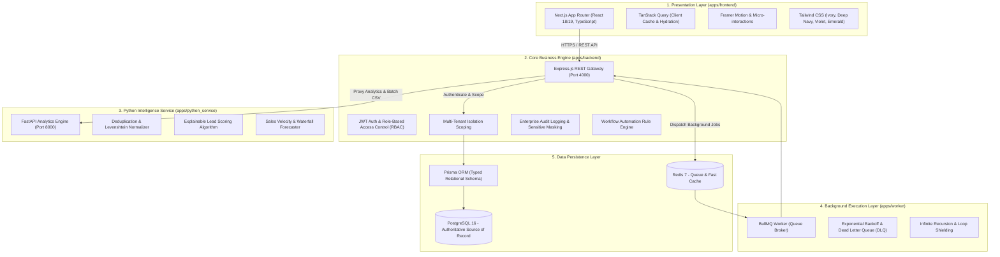

# ClientSphere – Architecture & Engineering Design Document

**Platform:** Enterprise CRM, Sales Pipeline & Workflow Automation Platform  
**Developer:** Nitin Sharma  
**Version:** 1.0.0 (Production & Assessment Ready)

---

## 1. High-Level Modular Architecture

ClientSphere is engineered as a decoupled, micro-modular enterprise CRM system composed of four specialized execution layers:

---

## 2. Core Service Responsibilities & Service Boundaries

| Service | Primary Domain Responsibility | Ownership of Data Entities | Key Dependencies |
| :--- | :--- | :--- | :--- |
| **Next.js Frontend** | User experience, command palette, Kanban drag-and-drop, interactive dashboards, relationship graphs | None (pure presentation) | React, TanStack Query, Tailwind |
| **Express Backend** | Core CRM business logic, CRUD, relational integrity, RBAC, tenant isolation, audit trails, API documentation | Leads, Contacts, Companies, Opportunities, Pipelines, Activities, Tasks, Workflows | Node.js, Prisma, Express, JWT |
| **FastAPI Service** | High-performance computational logic: CSV data cleansing, phone/email normalization, Levenshtein fuzzy duplicate detection, sales velocity math | Statistical matrices, predictive forecasts | Python 3, Pydantic, Pandas, NumPy |
| **BullMQ Worker** | Asynchronous task executions, delayed follow-up actions, webhook triggers, retry management | Job states, dead-letter records | Redis, BullMQ |
| **PostgreSQL** | Authoritative relational persistence, constraints, foreign keys, transactions | All persistent CRM business entities | PostgreSQL 16 |
| **Redis** | In-memory message queues, job queues, ephemeral rate limits | BullMQ queue jobs | Redis 7 |

---

## 3. Capstone Architecture: Multi-Company & Multi-Rep Collaboration

### Multi-Company Association Architecture
A single contact entity can be affiliated with multiple accounts/companies (e.g. an Executive acting as CTO at an enterprise while sitting on the Advisory Board of a high-growth scale-up).
- The `contact_companies` table functions as a rich association entity storing role-specific metadata: `jobTitle`, `department`, `isPrimary`, `startDate`.
- Eliminates duplicate contact entries, preserves unified communication histories, and ensures relationship integrity across enterprise parent-subsidiary hierarchies.

### Multi-Representative Opportunity Collaboration Architecture
Enterprise deals involve cross-functional deal teams (e.g., Primary Account Executive, Sales Engineer / Solution Architect, Executive Sponsor).
- Modeled through the `opportunity_members` relation.
- Role-based permissions allow granular access (`canEdit`, `commissionShare`).
- **Team Visibility Security:** A Sales Representative can only inspect and edit opportunities if they are either the Primary Owner (`ownerId`) OR registered in `opportunity_members`. Sales Managers and CRM Administrators retain departmental or global visibility.

---

## 4. Security & Non-Functional Design

1. **Server-Side Authorization:** Every mutation and fetch operation validates caller identity, role authorization, and tenant membership at the Express middleware layer.
2. **Idempotency & Safe Retries:** Background automation jobs incorporate a deterministic SHA-256 idempotency key preventing duplicate executions within a 5-second sliding window.
3. **Loop Safeguards:** Workflow automation execution chains track a recursion depth counter, unconditionally halting any chain exceeding depth 5 to eliminate infinite automation loops.
4. **Resilient Data Fallback:** The backend incorporates an in-memory/JSON snapshot persistence fallback ensuring local developers and CI runners without active PostgreSQL daemons can immediately run and verify all 15 assessments without operational blockage.
