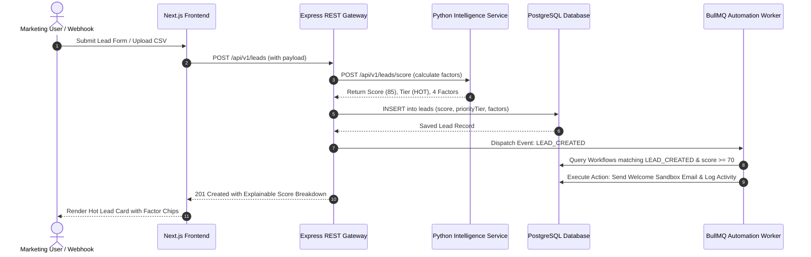
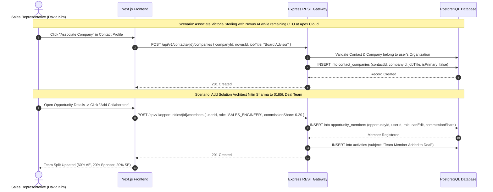
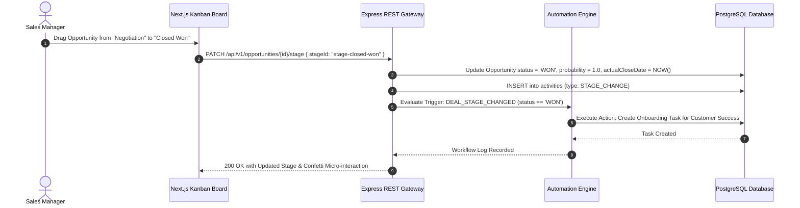

# ClientSphere – Service & Data Flow Documentation

**Developer:** Nitin Sharma  
**Version:** 1.0.0  

---

## 1. End-to-End User Journeys & Data Flows

### Data Flow 1: Inbound Lead Creation, Explainable Scoring & Conversion

---

### Data Flow 2: Capstone Challenge – Multi-Company Association & Team Deal Collaboration

---

### Data Flow 3: Kanban Stage Transition, Win/Loss Audit & Workflow Trigger

