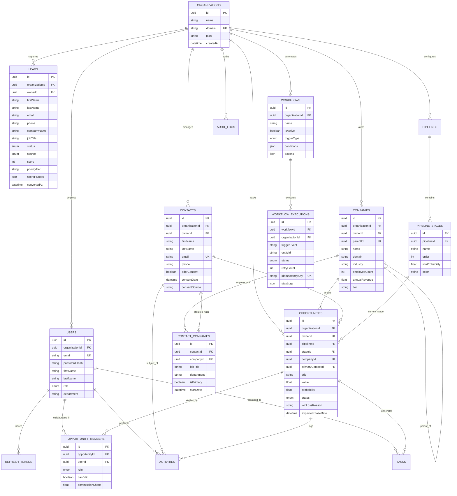

# ClientSphere – Database Entity-Relationship (ER) Documentation

**Database:** PostgreSQL 16  
**ORM:** Prisma ORM  
**Developer:** Nitin Sharma  

---

## 1. Complete Entity-Relationship Diagram

---

## 2. Relational Integrity, Constraints & Indexes

1. **Foreign Key Cascades:**
   - Deleting an Organization cascades and wipes related records cleanly.
   - Deleting a Contact cascades to its `contact_companies` associations without affecting the Company record.
   - Removing an Opportunity cascades its `opportunity_members` entries.
2. **Compound Unique Constraints:**
   - `contact_companies(contactId, companyId)`: A contact cannot have duplicate entries for the exact same company.
   - `opportunity_members(opportunityId, userId)`: Prevents duplicate membership records for the same team collaborator on a deal.
   - `contacts(organizationId, email)`: Enforces unique email per organization while allowing identical emails across different tenants.
3. **Optimized Indexes:**
   - Composite indexes on `[organizationId, status]` and `[organizationId, score]` for low-latency pagination and filtering.
   - Full indexing on `[stageId]` and `[ownerId]` for instantaneous Kanban board rendering.
